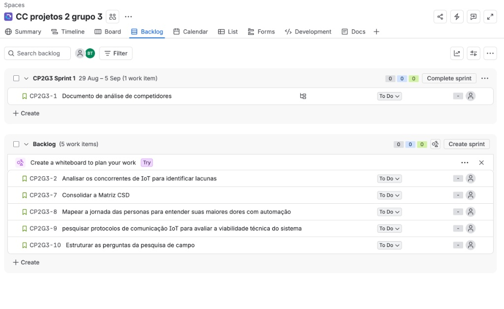
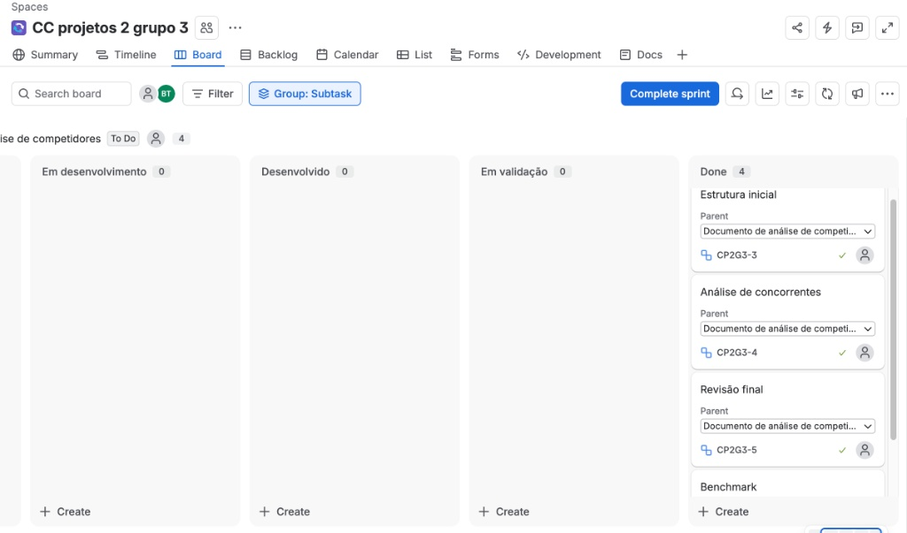
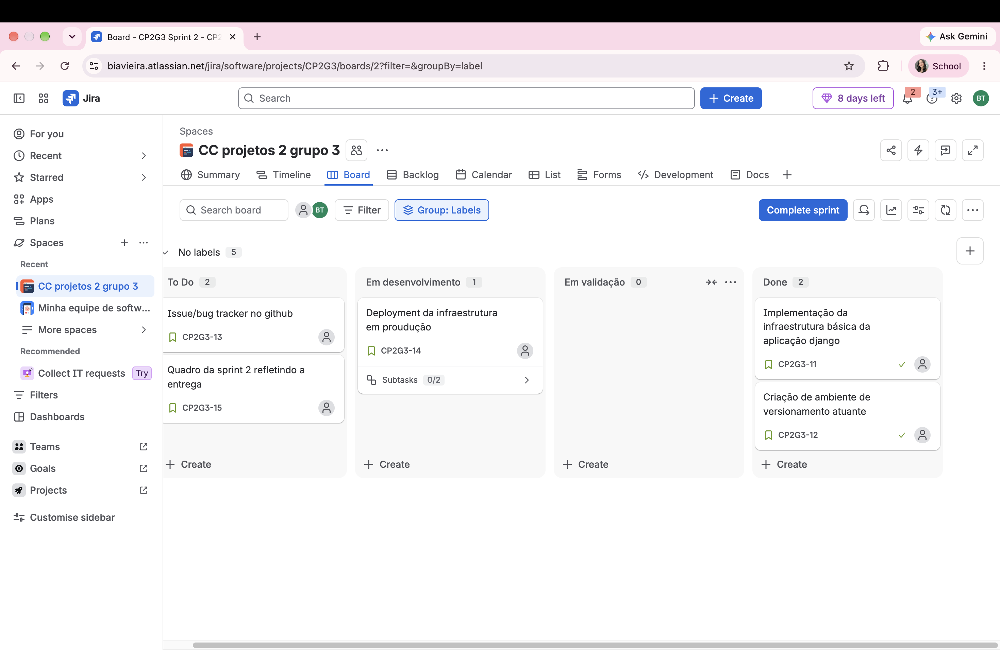
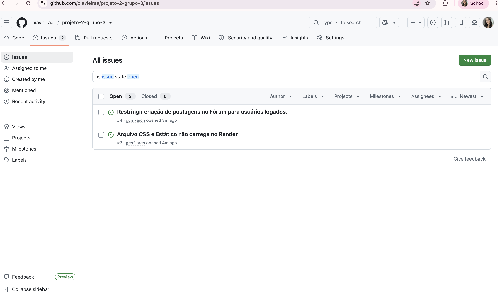
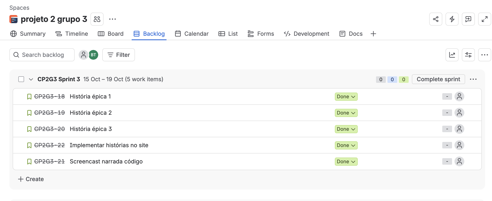

# BZU TECH — Grupo 3

Este repositório contém a documentação e o acompanhamento das etapas de desenvolvimento do nosso projeto, voltado para soluções de IoT. 

Para a organização das entregas e fluxo de trabalho da equipe, utilizamos a metodologia Scrum no Jira.

---

## Sobre o Projeto — Brian

O **Brian** é um chatbot baseado em Inteligência Artificial desenvolvido para a BZU TECH, nossa empresa cliente.

O principal propósito do projeto é tornar a Internet das Coisas (IoT) acessível e simples de entender para qualquer tipo de cliente. A tecnologia da IoT costuma envolver arquiteturas complexas, termos técnicos avançados e conceitos abstratos que podem afastar potenciais parceiros. O Brian surge para eliminar essa barreira de comunicação, traduzindo o funcionamento de hardware, software e nuvem em explicações didáticas, diretas e fundamentadas em analogias do cotidiano.

Além de educar o público sobre conceitos fundamentais, o Brian atua na apresentação detalhada do ecossistema de soluções da BZU TECH. Ele foi estruturado para demonstrar como a empresa entrega uma solução completa de ponta a ponta, que abrange desde os sensores que coletam dados em tempo real até os gateways que processam essas informações com segurança via criptografia em hardware, culminando na plataforma Bzu Cloud para análise, relatórios e alertas automáticos.

O projeto também capacita o assistente para contextualizar o impacto prático da IoT nos mais variados segmentos de mercado. O Brian consegue adaptar sua linguagem para exemplificar ganhos operacionais e redução de custos em cenários reais, como o controle rígido de temperatura na cadeia fria, a automação e medição contínua em utilities, o aumento de eficiência na Indústria 4.0, a gestão inteligente de edifícios, a coleta de dados ambientais no agronegócio e a aplicação de sensoriamento em cidades inteligentes.

Com isso, o Brian transforma a interação inicial do cliente em uma experiência educativa e estratégica, apresentando os diferenciais competitivos da BZU TECH, como a capacidade de criar projetos sob medida (IoT Tailor-Made), alta escalabilidade e ampla conectividade, preparando o terreno de forma natural para que o cliente compreenda o valor da tecnologia antes de ser direcionado às etapas comerciais.

## Equipe de Desenvolvimento

Somos estudantes do **2º período do curso de Ciência da Computação, turma A**, e desenvolvemos este projeto acadêmico para a BZU TECH.

| Integrante | E-mail |
|---|---|
| Beatriz Vieira | bvot@cesar.school |
| Bryan Martins | bmp@cesar.school |
| Gabriella de Lima | gla3@cesar.school |
| Gustavo Cavalcanti | gcnf@cesar.school |
| Heitor Villa-Chan | hvccp@cesar.school |
| Isabel Lucena | ial2@cesar.school |
| João Henrique Azevedo | jhmra@cesar.school |

## Quadro Scrum

O espaço de trabalho foi configurado no modelo Team-Managed com fluxo personalizado de colunas para acompanhar a evolução das tarefas:

* **To Do**
* **Em desenvolvimento**
* **Desenvolvido**
* **Em validação**
* **Done**

---

## Backlog do Produto (Desk Research)

Nesta etapa inicial do projeto, registramos no Backlog as Histórias de Usuário voltadas para a nossa equipe de pesquisa e desenvolvimento, além dos itens de documentação:

1. **Documento de análise de competidores** (Item de Documentação)
2. **Analisar os concorrentes de IoT para identificar lacunas**
3. **Consolidar a Matriz CSD**
4. **Mapear a jornada das personas para entender suas maiores dores com automação**
5. **Pesquisar protocolos de comunicação IoT para avaliar a viabilidade técnica do sistema**
6. **Estruturar as perguntas da pesquisa de campo**

### Backlog

---
## Entregas 

  

 Entrega 1 

## Sprint 1 — Análise de Concorrentes

Na Sprint 1, puxamos a entrega do Documento de análise de competidores e detalhamos o trabalho em subtarefas operacionais:

* Estrutura inicial do documento
* Análise de concorrentes (NOVUS, Data IoT, etc.)
* Benchmark
* Revisão final

Todas as subtarefas foram movimentadas ao longo do fluxo até a coluna **Done** ao final do ciclo.

### Quadro da Sprint 1

  
 Entrega 2 

  
### Quadro da Sprint 2
  

### Screencast do sistema em uso
https://youtu.be/4nRkAsJpJho?si=UtNhVNgx7p2iDae4

### Issues:

  
 Entrega 3 

  
## Escolha das histórias de usuários

Juntos, nos reunimos para decidir quais das 6 histórias de usuário eram mais relevantes e chegamos à essa conclusão:

https://www.figma.com/board/mO9zr2bNQ32quGHQzpMBIL/Prioriza%C3%A7%C3%A3o-ideias-FDS?node-id=0-1&t=a8loOoZIqqJIy463-1

As três histórias de usuário abaixo foram selecionadas para serem implementadas em nosso site:

> ### 1. Login da Conta
>
> **História de Usuário:**  
> *Como* usuário cadastrado,  
> *Quero* realizar o login com nome e senha,  
> *Para que* eu possa acessar o chat e os dados da minha empresa com segurança.
>
> ---
>
> **Cenários de Aceite (BDD):**
>
> **Cenário 1: Autenticação com informações válidas**
> - **Dado** que estou na tela de login
> - **Quando** preencho um nome de usuário e senha válidos e clico em *"entrar"*
> - **Então** o sistema valida as informações dadas do nome e senha do usuário
> - **E** sou redirecionado para a tela principal (do chatbot com minha sessão iniciada)
>
> **Cenário 2: Tentativa de login com informações inválidas**
> - **Dado** que estou na tela de login
> - **Quando** insiro um nome não cadastrado ou uma senha incorreta e clico em *"entrar"*
> - **Então** o sistema impede o acesso
> - **E** exibe a mensagem de erro: *"usuário ou senha incorretos!"*
>
> **Cenário 3: Validação de campos obrigatórios**
> - **Dado** que estou na tela de login
> - **Quando** tento clicar em *"entrar"* com ao menos um campo em branco
> - **Então** o sistema destaca os campos com uma mensagem abaixo deles de *"preencha esse campo"* e impede o login

> ### 2. Tirar Dúvidas com o Chatbot
>
> **História de Usuário:**  
> *Como* usuário logado,  
> *Quero* enviar perguntas ao chatbot,  
> *Para que* receba respostas rápidas sobre a operação e dados de IoT.
>
> ---
>
> **Cenários de Aceite (BDD):**
>
> **Cenário 1: Pergunta processada e respondida com sucesso**
> - **Dado** que estou na interface do chatbot com o login feito
> - **Quando** digito uma pergunta na caixa de texto e clico em *"enviar"*
> - **Então** a mensagem é exibida no histórico da conversa
> - **E** o chatbot exibe um indicador de processamento e responde em poucos segundos
>
> **Cenário 2: Pergunta fora do escopo ou incompreensível**
> - **Dado** que estou interagindo com o chatbot
> - **Quando** envio uma mensagem que o modelo não consegue interpretar
> - **Então** o chatbot responde informando que não compreendeu a solicitação
> - **E** sugere reescrever a dúvida ou utilizar os canais de suporte da Bzu Tech
>
> **Cenário 3: Falha de conexão durante o envio**
> - **Dado** que estou na aba de chat
> - **Quando** ocorre uma oscilação na conexão ao enviar uma pergunta
> - **Então** o sistema sinaliza que a mensagem não foi entregue
> - **E** exibe a opção *"tentar novamente"*

> ### 3. Adicionar Fotos e Documentos no Chat
>
> **História de Usuário:**  
> *Como* usuário do chatbot,  
> *Quero* anexar imagens e documentos na conversa,  
> *Para que* o chatbot analise o conteúdo e forneça respostas mais precisas.
>
> ---
>
> **Cenários de Aceite (BDD):**
>
> **Cenário 1: Envio de anexo e análise pelo chatbot**
> - **Dado** que estou no chat
> - **Quando** seleciono um arquivo dentro dos formatos permitidos (ex.: PDF, PNG, JPG) e envio
> - **Então** o arquivo é exibido no histórico da conversa
> - **E** o chatbot confirma o recebimento e processa as informações contidas nele
>
> **Cenário 2: Anexo de arquivo em formato ou tamanho não suportado**
> - **Dado** que abro a janela de seleção de arquivos
> - **Quando** tento anexar um arquivo com extensão não permitida ou com tamanho acima do limite estipulado
> - **Então** o sistema bloqueia o upload
> - **E** exibe uma mensagem informando as restrições do sistema
>
> **Cenário 3: Cancelamento de envio de anexo**
> - **Dado** que selecionei um arquivo para anexo na caixa de texto
> - **Quando** clico no ícone de remoção antes de enviar a mensagem
> - **Então** o arquivo é descartado e não é transmitido ao chatbot

#### Quadro da Sprint 3

  
 Entrega 4 

  
  Em andamento...

## Deployment da Infraestrutura em Produção

A aplicação foi implantada e está em execução no ambiente de produção.

* **Link do Projeto:** (https://django-fds-zz2o.onrender.com/forum/)
* **Plataforma de Hospedagem:** Render
* **Status:** Online

---

### Instruções de Acesso

1. **Acesso ao Fórum:** 
   * Navegue até a URL (https://django-fds-zz2o.onrender.com/forum/) para visualizar as discussões e tópicos ativos.
2. **Autenticação de Usuário:**
   * Clique em **Entrar** na navegação principal para realizar o login e obter acesso à criação/edição de conteúdos no fórum.

#### Quadro da Sprint 3

